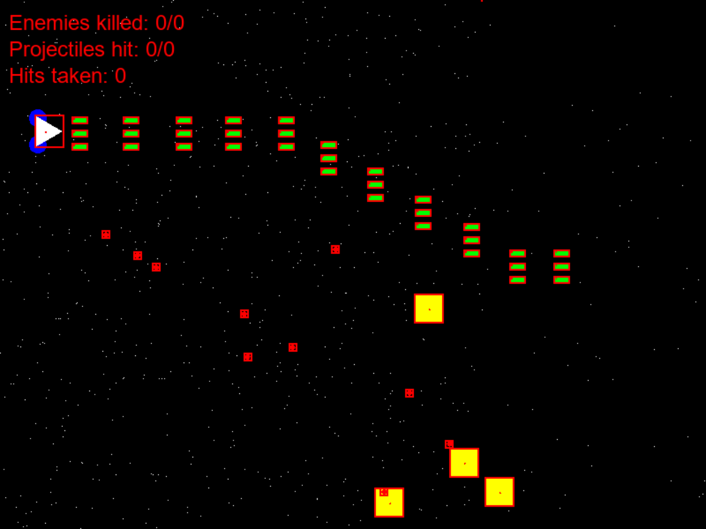

# Yip

A side-scrolling space shooter in SFML 3.1 (C++23, x86), built on kazilib.

The world scrolls right; the ship (the white triangle) moves inside the left 80 % of
the screen and fires at the yellow enemies, which fire red shots back at it.

**Play it in your browser: https://kazin.dev/projects/yip/** (Ctrl+E brings enemies,
A fires, the arrows fly)



## Keys

| Key | What |
|---|---|
| Enter / click Start Game | from the menu into a new game |
| Arrows | move (Left / Right against the scroll, Up / Down) |
| A (held) | fire, every 100 ms |
| 1 / 2 / 3 | weapon: Normal / Laser / Triple (Laser fires the normal shot for now) |
| Ctrl+E | an enemy, off the right of the screen |
| Escape | back to the menu |

The top left shows enemies beaten (of those that came), shots that hit (of those
fired) and the enemy shots taken. `DEBUG_MODE` (`global.h`) draws each object's
origin and collider in red.

## Build

```
powershell -ExecutionPolicy Bypass -File build.ps1
```

`setup.ps1` (run by `build.ps1`) checks out the kazilib submodule (`src\dep\kazilib`)
and SFML 3.1.0 x86 (`src\dep\SFML-3.1.0`: a junction to `D:\code\kazilib\SFML-3.1.0`
when it is there, else the official 32-bit release, downloaded). The build is kazilib's
FASTBuild tool on `src\fastbuild.json`: Release, x86, the 64-bit-hosted tools, v145,
distributed to the workers that answer. Output: `deploy\yip.exe` with SFML's DLLs and
the fonts beside it. `-Configuration Debug` builds `yip_d.exe`.

## Launch flags (kazilib `initflags.h`)

`title=<text>` (the window's title), `fps` (prints the logic / render counts each
second), `catchexceptions` (an exception writes `deploy\exceptions\exception_<pid>.txt`
and ends the run, no JIT dialog), `testerino=<slot>` (the test bridge).

## Tests

`node src\dep\kazilib\testerino\tt.js run src\tests\testerino\play.tt` plays it end to
end: the menu, Start Game, the weapons, an enemy beaten, moving to the edges, missed
shots, Escape and a fresh game (report in `testerino\reports\play.txt`, screenshots in
`testerino\client_1\shots\`). The bridge's verbs (`help` lists them): `state`, `key`,
`hold` / `release` (keys the game reads every tick), `spawn`, `click`, `shot`, `quit`;
conditions `scene=`, `killed=` / `killed~` (at least), `enemies=`, `hits_taken=`.

## In a web browser

Play at **https://kazin.dev/projects/yip/**. The same game compiled to WebAssembly
(Emscripten), drawing and keys unchanged:

- **SFML 3.1 for the web**: kazilib's patch (`src\dep\kazilib\web\`, its README). SFML's
  window runs on SDL3, its OpenGL ES 1 drawing is emulated on WebGL2.
- **The loop**: in a browser one logic tick and one frame per pass (`App::Tick`):
  `display()` waits for the browser's next animation frame, and the logic moves by the
  real time passed. Keys are read through SDL's keyboard state (`input::Held`).
- **Scaled Window** (the default), **Original Size** (`?scale=fit` / `?scale=fixed`) and
  **Fullscreen** under the game: the 800x600 game scaled, its aspect kept (kazilib
  `web/shell.html`). The query string is the launch flags (`?fps`).
- No sound to lose (yip plays none) and no server: single-player, static files only.

```
powershell -ExecutionPolicy Bypass -File build_web.ps1
```

`build_web.ps1` builds `src\yip\CMakeLists.txt` with Emscripten (`D:\code\tools\emsdk`)
against kazilib's SFML web build (`-Deps <folder>`, default `D:\code\tools\kazilib-web`;
built there by `src\dep\kazilib\web\build_deps.ps1` when missing) and copies
`index.html` / `.js` / `.wasm` / `.data` (the font) to `web\`.

Test: `src\tests\web\run_web_test.ps1` serves `web\` to headless Edge (kazilib
`web\tools\browser.js`), clicks Start Game, spawns enemies with Ctrl+E, holds the
arrows and A until an enemy is beaten (the console's `Enemy beaten: 1`), then Escape and
Enter into a fresh game; steps in `src\tests\web\play.json`, canvas shots in
`testerino\web\`. `-Url https://kazin.dev/projects/yip/` runs it on the live page.

## Deployment

```
powershell -ExecutionPolicy Bypass -File deploy_ubuntu.ps1   # build_web.ps1, upload, install
```

It sends the web build and `deploy\ubuntu\` to the box `kazin-music` and runs
`install.sh` there: the files swapped whole into `/opt/yip/web`, Caddy's snippet
`/etc/caddy/sites/kazin.dev.d/yip.caddy` (`/projects/yip/*` from that folder; Caddy
validated, then restarted, only when the snippet changed). `-NoBuild` sends the last build.

Screenshots of the live page: `docs\showcase\` (canvas shots), `docs\showcase\kazin\`
(1024x768 JPEGs for kazin.dev/projects: `yip.jpg` the thumbnail, `yip-1` .. `yip-4`).
